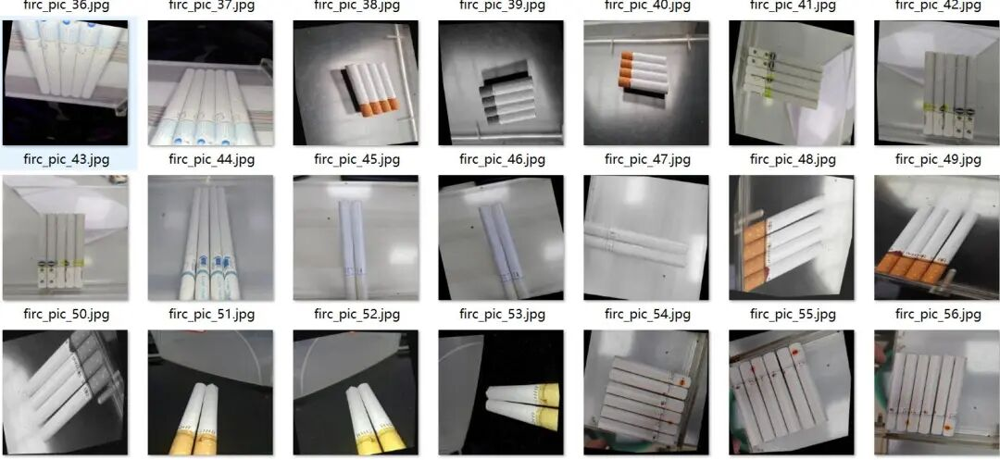
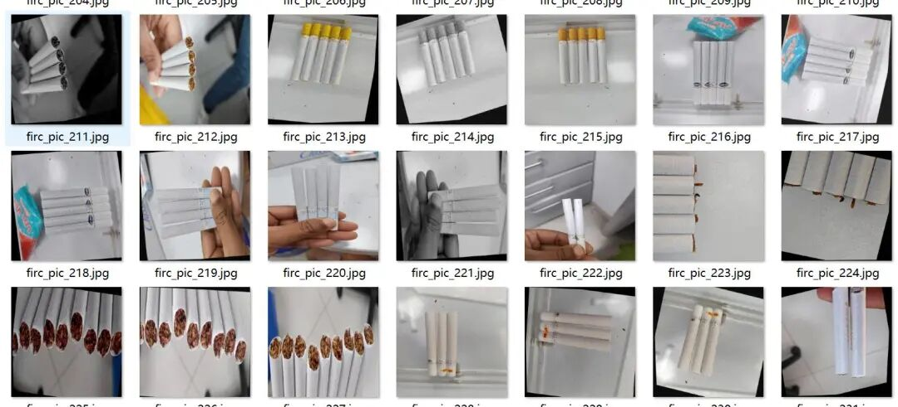
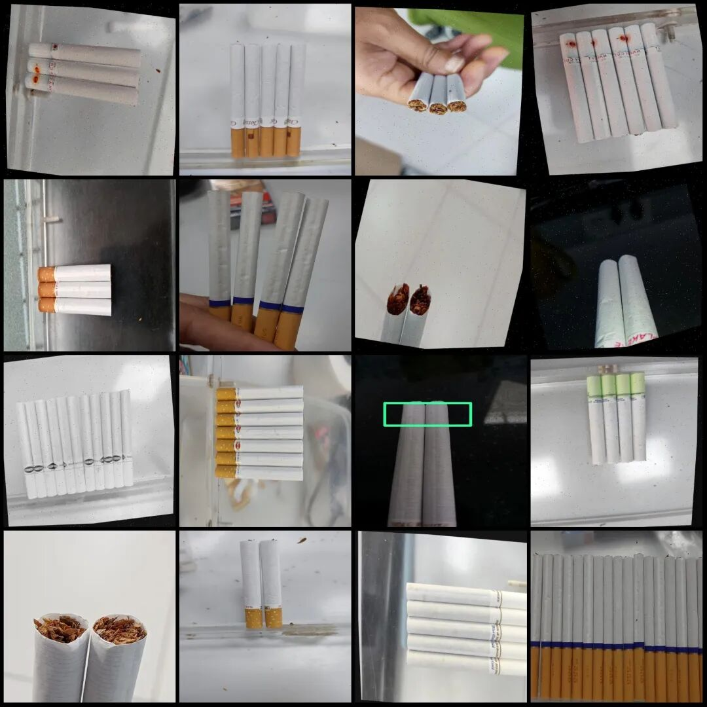
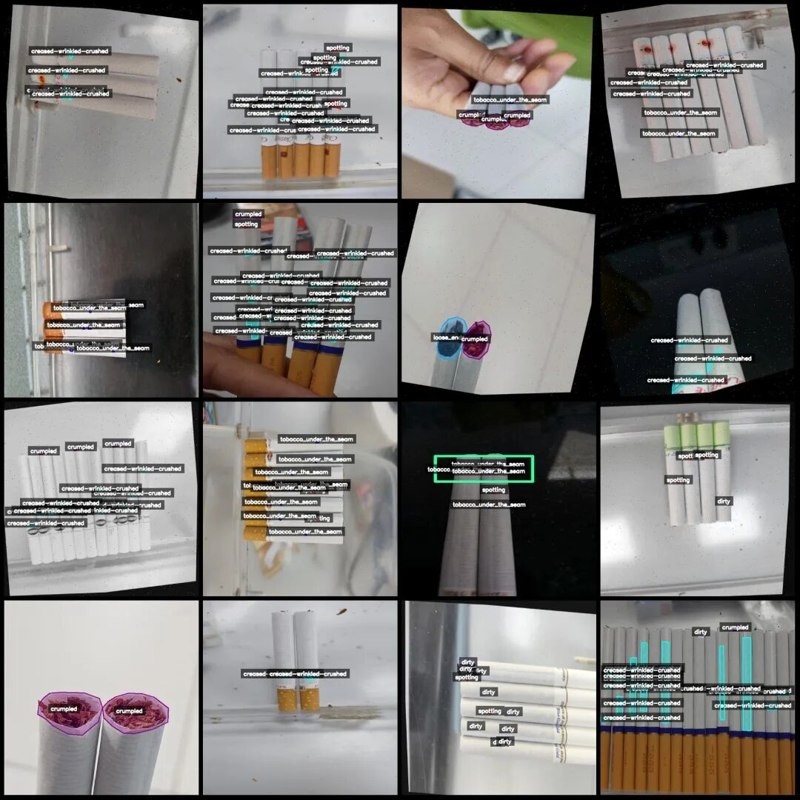
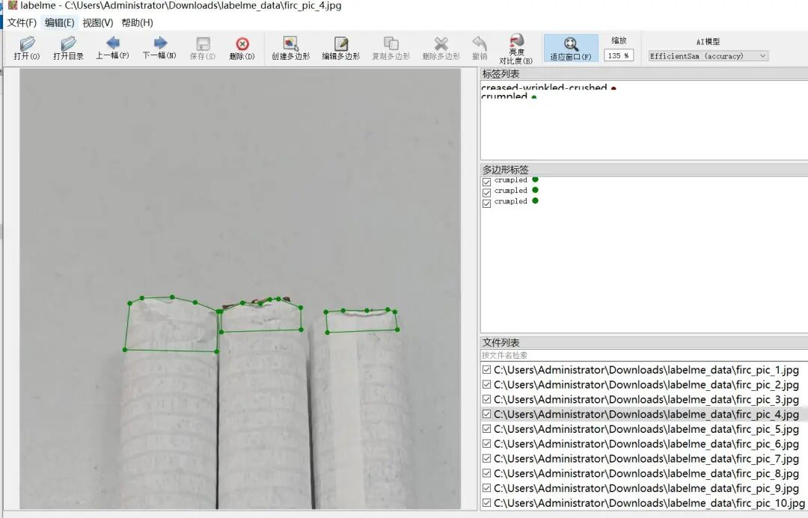

# Cigarette Defect Identification and Segmentation Dataset in LabelMe format with 825 images, 9 categories with enhancements

Note: There are a large number of enhancements in the dataset, approximately 300 original images remaining, all of which are rotation enhanced.

Dataset format: labelme format (without mask files, only including jpg images and corresponding json files)

Number of images (number of jpg files): 825

Number of annotations (number of json files): 825

Label category count: 9

Annotation category names: ["creased-wrinkled-crushed", "crumpled", "dirty", "flattened", "loose_ends", "punctured-torn", "recessed_ends", "spotting", "tobacco_under_the_seam"]

Number of boxes labeled in each category:

Creased-wrinkled-crushed (folds/wrinkles/pressure marks) count = 2779

Crumpled count = 1168

Dirty count = 338

Flattened (pressed) count = 145

Loose ends (ends that are loose) count = 120

Pulverized-torn (pierced/tearing) count = 46

recessed_ends (end recess) count = 10

Spotting count = 413

Tobacco Under the Seam (Smoked Tobacco at the Seam) Count = 733

Total frame count: 5752

Using labeling tool: labelme=5.5.0

Image resolution: 640x640

Annotation rules: Draw polygons around the categories.

Important Notice: The dataset can be opened and edited using LabelMe. For JSON datasets, one must convert them into mask or Yolo formats for semantic segmentation or instance segmentation.

Special : This dataset does not guarantee the accuracy of the trained models or weight files.

Image Preview:

Annotation example:

Original image (pick 16 randomly):

Annotation:

LabelMe editing example:

## Payment

Here is a pay link on Stripe ( https://buy.stripe.com/3cs8yP7sY87d0vu9AB ). Please contact me lonlonago@foxmail.com after funding $89, and I will send you a complete data files , thank you!

